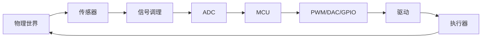

# 电子基础：先能解释，再能算，再能测

> 目标不是学完《模拟电子技术》，而是能看懂一个最简单的电路，能用万用表验证，能在面试里讲清概念。

## 1. 四个基本量

| 量 | 符号 | 单位 | 直觉 |
| --- | --- | --- | --- |
| 电压 | V | 伏特 V | 两点之间的“电势差”，像水压 |
| 电流 | I | 安培 A | 电荷流动的速率，像水流 |
| 电阻 | R | 欧姆 Ω | 对电流的阻碍，像水管变细 |
| 功率 | P | 瓦特 W | 能量消耗/转换的速率 |

水类比：

```text
电压 = 水压
电流 = 水流量
电阻 = 水管阻力
功率 = 水流做功的速率
```

注意：真正通过人体造成伤害的是电流和路径，不是单纯的“电压数字”。安全规则仍然按电压等级来定。

## 2. 欧姆定律与功率

```text
V = I × R
P = V × I = I² × R = V² / R
```

例子：5V 电源、红色 LED 压降约 2V、目标电流 10mA。

```text
R = (5V - 2V) / 0.01A = 300Ω
取标准值 330Ω
P = (5V - 2V) × 0.01A = 0.03W
```

所以 330Ω、1/4W 电阻足够。LED 必须限流，不能直接接 5V。

## 3. 串联与并联

- 串联：电流相同，电压分配；`R_total = R1 + R2`。
- 并联：电压相同，电流分配；`1/R_total = 1/R1 + 1/R2`。

分压公式：

```text
Vout = Vin × R2 / (R1 + R2)
```

分压常用于把 5V 信号降到 3.3V 能接受的范围；但要注意负载会改变分压比，不能随便拿来给模块供电。

## 4. 交流与直流、模拟与数字

- 直流 DC：电压方向不变，电池、USB 5V。
- 交流 AC：电压方向周期性变化，家里插座 220V/50Hz。
- 频率 `f = 1/T`，周期 T 是一个完整波形的时间。
- 模拟信号：连续变化，如温度传感器输出电压。
- 数字信号：用高低电平表示 0/1，如按钮、串口、I2C。

数字不是“没有模拟问题”：上升沿、噪声、反射、地弹都会影响 0/1 的判决。示波器就是用来看这些的。

## 5. 常见元件

| 元件 | 作用 | 典型场景 | 注意 |
| --- | --- | --- | --- |
| 电阻 | 限流、分压、上拉/下拉 | LED 限流、按键 | 功率要够 |
| 电容 | 储能、滤波、去耦、隔直 | 电源去耦、RC 滤波 | 电解电容有极性 |
| 电感 | 储能、滤波、升压 | 开关电源 | 饱和电流 |
| 二极管 | 单向导电、整流、续流 | 电源防反接、继电器续流 | 压降与方向 |
| LED | 发光 | 指示灯 | 必须限流 |
| 三极管 BJT | 电流控制开关/放大 | 小负载驱动 | 基极电阻 |
| MOSFET | 电压控制开关 | 电机、加热器、电源 | 栅极驱动、导通电阻 |
| 继电器 | 电磁开关、隔离 | 控制市电负载 | 线圈续流、触点寿命 |
| 运算放大器 | 放大、比较、滤波 | 传感器信号调理 | 供电范围、带宽 |
| 传感器 | 物理量 → 电信号 | 温度、距离、光、IMU | 量程、精度、接口 |
| 执行器 | 电信号 → 动作 | 电机、舵机、加热片 | 电流、驱动 |

## 6. 工具

### 面包板

- 中间凹槽两侧的孔，每一列 5 个孔内部相连。
- 两侧长条通常是电源轨，整条相连。
- 元件跨在中间凹槽上，不要把同一个元件的两只脚插进同一列。

### 万用表

- 电压：并联在被测两点，选 DC/AC 档。
- 电流：串联进回路，选合适量程；不要用电流档直接测电源两端。
- 电阻/通断：断电测量。
- 先选大量程，再往下调；不确定时先看说明书。

### 电源

- 用带限流的实验室电源最安全：先设电压，再设电流上限。
- USB 5V 方便，但电流有限；电机/舵机要独立供电。
- 所有模块必须共地，除非使用隔离电源。

### 示波器

- 看“电压随时间怎么变”：PWM、串口波形、传感器噪声、电源纹波。
- 探头地夹必须接电路地；不要夹到非地节点。
- 先调时基和电压档，再用触发稳定波形。

## 7. 一条信号链



例子：温度控制

```text
温度 → 热敏电阻/数字传感器 → MCU 读取 → 比较目标值 → PWM 控制加热片 → 温度变化 → 再读取
```

## 8. 上拉/下拉与按键

按键一端接 GPIO，另一端接 GND：

- 使用内部上拉：`pinMode(buttonPin, INPUT_PULLUP);`
- 未按下时读到 HIGH，按下读到 LOW（低电平有效）。
- 如果引脚悬空，读数会乱跳；上拉/下拉给它一个确定的默认电平。

按键抖动：

- 机械触点闭合/断开时会弹跳几毫秒到几十毫秒。
- 软件去抖：读两次，间隔 10–20ms，状态一致才认。
- 硬件去抖：RC 滤波 + 施密特触发器。

## 9. 安全

- 本项目只做低压（3.3V/5V/12V）直流；不要碰市电。
- 继电器控制市电必须由有经验的人指导，并做好绝缘、外壳、保险丝。
- 电解电容可能存电，断电后仍要放电。
- 焊接注意通风、烙铁架、不要烫伤线皮。
- 拿 MOS/IC 前先释放静电；干燥季节尤其注意。

## 10. 小练习

1. 用 5V、LED 压降 2V、目标 15mA，算限流电阻。
2. 用万用表测一节电池的电压，再测一个电阻的阻值。
3. 搭一个按键 + LED：按下亮，松开灭；加上 20ms 去抖。
4. 用示波器看 Arduino 的 PWM 输出，改变占空比，观察平均电压。
5. 给一个 3.3V 传感器和 5V 单片机做电平转换，画两种方案并说明代价。

## 11. 面试一句话

- **电压/电流**：电压是两点电势差，电流是电荷流动；真正驱动负载的是电流，但电流由电压和阻抗决定。
- **模拟/数字**：模拟是连续量，数字用离散电平表示；数字电路也要处理噪声、时序和地。
- **LED 为什么要电阻**：LED 的伏安特性很陡，直接加电压电流会失控；电阻把电流限制在额定范围。
- **去耦电容**：靠近芯片电源脚放，给瞬态电流一个本地储能，降低电源纹波和地弹。
- **上拉电阻**：给悬空输入一个确定电平；阻值太大易受干扰，太小功耗大。
- **三极管/MOS**：BJT 电流控制，MOS 电压控制；驱动电机更常用 MOS 或专用驱动芯片。

## 12. 常见误区

- “5V 单片机能直接读 5V 传感器，所以 3.3V 的 ESP32 也可以。”——不行，3.3V 引脚通常不耐 5V。
- “电机接 GPIO 就能转。”——GPIO 只能给信号，电机要驱动器和独立电源。
- “电池 mAh 越大，输出电流越大。”——mAh 是容量，不是瞬时电流能力。
- “数字信号只有 0 和 1，所以不会出问题。”——时序、噪声、地线都会让 0/1 判错。
- “电容越大越好。”——太大的电容会带来浪涌电流、稳定性和体积问题。

先能把上面的概念用自己的话讲清，再谈做题和项目。
