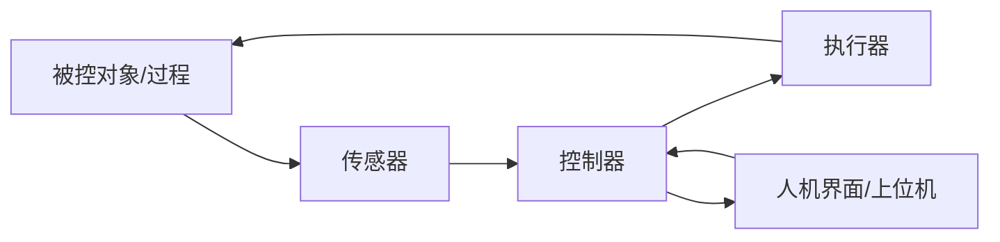

# 怎么实现自动化

> 面试老师问“怎么实现自动化”，不是要你报一个产品型号，而是看你能不能把一个“想让机器自己干活”的想法拆成可实现的系统。

## 1. 一句话定义

自动化 = 用系统替代人的**感知、判断、执行**，并通过**反馈**把结果稳定在目标附近。



四个核心：

1. **感知**：传感器把温度、位置、颜色、压力等变成电信号。
2. **判断**：控制器按规则/算法决定下一步动作。
3. **执行**：执行器（电机、继电器、阀门、加热器）改变物理世界。
4. **反馈**：再次测量，比较目标与实际的偏差，修正。

没有反馈的叫**开环**；有反馈的叫**闭环**。

## 2. 开环 vs 闭环

| | 开环 | 闭环 |
| --- | --- | --- |
| 是否测量结果 | 不测 | 测 |
| 例子 | 定时加热 10 分钟 | 恒温到 60°C |
| 优点 | 简单、便宜 | 抗扰动、精度高 |
| 缺点 | 环境一变就偏 | 需要传感器、调参、可能振荡 |
| 面试说法 | “按预设动作执行，不保证结果” | “测量偏差并修正，保证结果” |

例子：

- 开环：洗衣机按固定时间转 15 分钟。
- 闭环：恒温箱测到 60°C 就停，低于 58°C 再加热。

## 3. 控制器选什么

| 方案 | 适合 | 优点 | 缺点 |
| --- | --- | --- | --- |
| 继电器/定时器 | 简单定时、通断 | 便宜、直观 | 不能复杂逻辑 |
| PLC | 工业产线、可靠、模块化 | 抗干扰、生态成熟 | 贵、体积大 |
| MCU（STM32/ESP32） | 中小型设备、嵌入式 | 便宜、灵活、低功耗 | 需要自己写固件、做保护 |
| 工控机/PC | 视觉、复杂算法、上位机 | 算力强、生态好 | 功耗、成本、实时性弱 |
| 云端 | 远程监控、数据汇总 | 可扩展 | 依赖网络，不能做硬实时 |

面试不要只说“用单片机”。先说需求：I/O 数量、实时性、成本、环境、是否需要联网；再说选型。

## 4. 控制算法

### 开关控制（Bang-Bang）

```text
温度 < 58°C → 加热
温度 > 60°C → 停止
```

简单，但会在目标附近来回跳。加**滞回**（58–60°C）可以减少抖动。

### PID

```text
输出 = Kp × 误差 + Ki × 误差累积 + Kd × 误差变化率
```

- P（比例）：误差越大，动作越大；太大振荡，太小迟钝。
- I（积分）：消除长期偏差；太大会超调/积分饱和。
- D（微分）：抑制变化趋势，减少超调；对噪声敏感。

直觉：P 是“现在差多少”，I 是“过去一直差多少”，D 是“正在往哪变”。

P0 的桌面项目可以先不用 PID；恒温、电机速度、位置控制再引入。

### 状态机

把系统拆成状态和转移：

```text
待机 → 检测到人 → 亮灯 → 延时 → 待机
```

状态机让逻辑可读、可测试，比一堆 `if` 更可靠。

## 5. 三个例子

### 例 1：恒温箱

```text
目标 60°C
温度传感器 → MCU 读取 → 与目标比较 → PWM 控制加热片 → 温度变化 → 再读取
```

要点：

- 传感器有噪声 → 滤波/平均。
- 加热有惯性 → 提前关断或 PID，减少超调。
- 安全 → 独立过温保护、保险丝、继电器失效方向。

### 例 2：自动分拣

```text
传送带 → 颜色/距离传感器 → 控制器判断 → 气缸/推杆把物体推入对应料箱
```

要点：

- 物体到达检测点的时刻 → 延时/编码器定位。
- 开环延时受速度影响；闭环用编码器/光电开关确认。
- 卡料检测、急停、故障报警。

### 例 3：智能家居

```text
ESP32 → Wi-Fi → MQTT/HTTP → 手机/云端
        → 继电器 → 灯/风扇
        → 温湿度传感器 → 自动控制
```

要点：

- 本地手动开关必须保留（网络挂了还能用）。
- 断电恢复后的状态要定义（默认关还是保持）。
- 配网、断线重连、OTA、日志。

## 6. 安全与可靠性

自动化系统出问题往往不是“算法不聪明”，而是：

- 传感器坏了，控制器以为一切正常。
- 执行器卡住，电流飙升。
- 通信断了，系统停在危险状态。
- 急停按钮不起作用。

基本措施：

- 急停（硬件切断执行器电源，不只是软件）。
- 限位开关/软件限位/电流检测。
- 看门狗、超时、心跳。
- 故障安全方向：断电时阀门关、电机停、加热断开。
- 传感器合理性检查（范围、变化率、冗余）。
- 手动/自动切换，手动优先。

## 7. 60 秒回答模板

> 自动化本质是把人的感知、判断、执行拆成传感器、控制器、执行器，并用反馈形成闭环。传感器采集被控对象的实际状态，控制器把实际值和目标值比较，按开关控制、PID 或状态机决定动作，执行器改变物理世界，然后再次测量。比如恒温箱：温度传感器测温度，MCU 比较 60°C 目标，PWM 控制加热片，温度低了加热、高了停止；为了提高稳定性可以加 PID 和过温保护。开环简单但抗扰动差，闭环稳定但需要传感器和调参，实际选型还要看实时性、成本、环境和安全。

## 8. 3 分钟白板讲法

1. 画被控对象（一个方框）。
2. 左边画传感器，右边画执行器，中间画控制器。
3. 从执行器回到传感器画反馈箭头。
4. 标出目标值、误差、控制量。
5. 选一个例子（恒温箱/分拣/智能家居）走一遍。
6. 讲开环/闭环取舍。
7. 讲安全（急停、限位、故障方向）。
8. 讲你下一步会怎么验证（传感器读数、执行器响应、超调、稳定时间）。

## 9. 常见追问

**“PLC 和单片机有什么区别？”**

> PLC 是工业化的控制器，模块化、抗干扰、接线和编程偏梯形图，适合产线和强电环境；单片机是芯片级方案，便宜、灵活、低功耗，适合中小设备和嵌入式产品。选哪个看可靠性、I/O、环境、成本和维护。

**“PID 三个参数怎么调？”**

> 先把 I、D 置零，增大 P 到有响应但不持续振荡；再加 I 消除稳态误差；最后加 D 抑制超调。实际还要考虑采样周期、噪声、积分饱和和执行器限幅。

**“怎么保证实时性？”**

> 明确控制周期和截止时间；用定时器中断/RTOS 任务保证采样和控制节拍；把耗时操作移出中断；必要时用 DMA、硬件外设和更快的 MCU；用示波器/逻辑分析仪测量抖动。

**“传感器坏了怎么办？”**

> 范围检查、变化率检查、冗余/交叉验证、超时检测；进入安全状态并报警。不能假设传感器永远正确。

**“为什么不用 AI？”**

> AI 适合感知和复杂决策，但底层控制需要确定性、实时性和可验证性。实际系统常是“AI 做识别/规划，MCU/PLC 做实时闭环和安全”。

## 10. 最小项目：自动夜灯 / 智能风扇

自动夜灯：

- 光敏电阻/光照传感器 → ESP32 ADC → 判断暗 → PWM/继电器开灯。
- 加滞回，避免临界点闪烁。
- 加手动开关和超时。

智能风扇：

- 温度传感器 → 比较阈值 → PWM 控制风扇转速。
- 加手动档位、故障保护、转速反馈（可选）。

这两个项目都能在 1–2 天内做完，面试时能讲“感知→判断→执行→反馈”。

## 11. 不要这样说

- “自动化就是机器换人。”——太口号，没有系统。
- “用 AI 就行了。”——没有实时性、安全和执行器。
- “买个 PLC 接上线就好了。”——没有需求分析和取舍。
- “闭环一定比开环好。”——成本、复杂度、可靠性都要看场景。

## 12. 一句话总结

> 自动化的核心不是“让机器动”，而是“让机器根据测量结果，稳定地动到目标，并在出错时安全地停下”。
