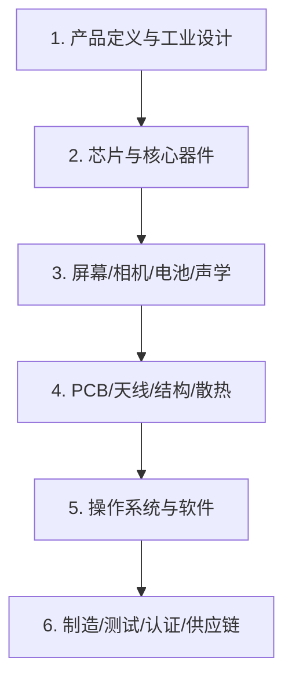

# 怎么造手机

> 老师问“怎么造手机”，通常不是要你背供应链，而是看你能否把一个复杂系统拆成层次，并理解其中的取舍。
> 没有一个人能独立造出现代手机；它是一整套芯片、器件、软件、制造和供应链的协作。

## 1. 先给结论

一部手机可以拆成六层：



面试时先讲这六层，再选一层深入。不要一上来报零件名。

## 2. 六层拆解

### 第 1 层：产品定义与工业设计

- 卖给谁、什么价位、主打拍照/续航/轻薄/游戏？
- 尺寸、重量、材质、颜色、防水等级。
- 这些决定后面的芯片选型、电池容量、散热和成本。

### 第 2 层：芯片与核心器件

| 器件 | 作用 |
| --- | --- |
| SoC | CPU/GPU/ISP/NPU 等集成，跑系统和应用 |
| 基带/Modem | 蜂窝通信（4G/5G），协议栈 |
| RF 前端 | 功放、滤波器、开关、天线调谐 |
| PMIC | 电源管理，多路电压/充电/电池保护 |
| 音频 Codec | 麦克风/扬声器/耳机 |
| 传感器 | 加速度计、陀螺仪、磁力计、光感、距离 |
| NFC/无线 | 刷卡、Wi-Fi/BT/GPS |

关键点：SoC 不是手机的全部；基带、射频、电源、天线和软件同样决定体验。

### 第 3 层：屏幕、相机、电池、声学

- 屏幕：LCD/OLED、分辨率、刷新率、触控、亮度、寿命。
- 相机：传感器、镜头、光圈、OIS、ISP 算法。
- 电池：容量、能量密度、充电倍率、循环寿命、安全。
- 声学：扬声器、麦克风、降噪、回声消除。
- 触觉：线性马达。

这些器件与第 1 层的产品定义强耦合：轻薄 vs 续航、影像 vs 厚度。

### 第 4 层：PCB、天线、结构与散热

- PCB/FPC：把芯片和器件连起来；层数、阻抗、EMC。
- 天线：蜂窝/Wi-Fi/BT/GPS/NFC；净空、人体手部影响。
- 屏蔽：防止射频干扰。
- 散热：均热板、石墨、导热界面材料；性能与温控策略。
- 结构：中框、玻璃/金属、防水密封、跌落可靠性。
- 测试：信号完整性、电源完整性、EMC、跌落、盐雾、老化。

### 第 5 层：操作系统与软件

- Bootloader → OS（Android/iOS）→ 驱动 → 框架 → 应用。
- 驱动：屏幕、相机、音频、传感器、充电、射频。
- 系统服务：电源管理、热管理、权限、更新、安全。
- 应用生态与开发者工具。
- OTA、回滚、签名、安全启动。

手机是“硬件 + 操作系统 + 应用生态”的系统，不是只有硬件。

### 第 6 层：制造、测试、认证与供应链

制造流程（简化）：

```text
SMT 贴片 → 主板测试 → 组装屏幕/电池/相机 → 整机测试
→ 校准（射频/传感器/屏幕）→ 老化/可靠性 → 包装 → 出货
```

关键概念：

- SMT：表面贴装，把元件焊到 PCB。
- 良率：制造中合格品的比例；直接影响成本。
- 校准：射频、传感器、屏幕色彩等逐台校准。
- 测试：功能、性能、可靠性、环境、跌落、EMC。
- 认证：3C/CE/FCC 等（按市场）。
- 供应链：芯片、屏幕、电池、镜头、结构件的交期与产能。

## 3. 关键取舍

| 取舍 | 影响 |
| --- | --- |
| 轻薄 vs 电池 | 电池容量、散热、结构强度 |
| 性能 vs 发热 | SoC 频率、散热设计、降频策略 |
| 拍照 vs 厚度 | 相机模组、OIS、镜头 |
| 成本 vs 体验 | 器件等级、良率、测试成本 |
| 信号 vs 外观 | 天线净空、金属中框、防水 |
| 上市时间 vs 验证 | 测试周期、供应链成熟度 |

面试时能说出 2–3 个取舍，比背 20 个零件名更有说服力。

## 4. 60 秒回答模板

> 手机不是一个零件，而是一个系统集成产品。大致分六层：先定义产品和工业设计；再选 SoC、基带、射频、电源等芯片；然后是屏幕、相机、电池、声学这些器件；接着是 PCB、天线、结构、散热和 EMC；再往上操作系统、驱动和应用生态；最后是 SMT、组装、校准、测试、认证和供应链。每一层都互相约束，比如轻薄会压缩电池和散热，性能会带来发热，天线又受金属中框影响。所以造手机的核心不是“把零件装起来”，而是系统设计、取舍和供应链管理。

## 5. 3 分钟展开

1. 先讲六层（30 秒）。
2. 选“芯片/射频”或“电池/散热”深入（60 秒）。
3. 讲一个取舍（30 秒）：轻薄 vs 续航、性能 vs 发热。
4. 讲制造与测试（30 秒）：SMT、组装、校准、测试、良率。
5. 讲软件与生态（30 秒）：OS、驱动、OTA、安全。
6. 收尾：没有一个人能独立造手机；这是系统工程。

## 6. 被问到不会的细节

不要编。用这个结构：

> 这个具体工艺我还没有深入了解。我目前的理解是……（说出你知道的上下游/目的）。如果我要弄清楚，我会去看……（datasheet/拆解/工艺文档），并确认……（关键指标）。

老师更在意你的思维方式，而不是你是否知道某个封装名称。

## 7. 一个“手机-like”的小项目

不要声称“我造了手机”。可以做一个**手持传感终端**，展示同样的系统分层：

- ESP32 + OLED + 锂电池 + 充电模块 + 温湿度/光感传感器 + 3D 打印外壳。
- 功能：显示环境数据、低电量提示、深睡/唤醒、通过 Wi-Fi 上报。
- 讲法：这不是手机，但它覆盖了“主控、显示、电源、传感器、无线、结构、固件”这些手机也会遇到的子系统。

项目文档模板见 [projects/README.md](../projects/README.md)。

## 8. 推荐了解

- iFixit 拆解：看真实手机的内部结构、模块化、螺丝/排线/电池。
- 《Code》Charles Petzold：从电到逻辑门到计算机，补“手机为什么能计算”的底层直觉。
- 芯片/模组 datasheet：选一个 SoC 或传感器，看看电源、时钟、接口、封装。
- 通信基础：调制、频段、天线、信噪比；先建立概念，不要求推导。

## 9. 不要这样说

- “手机就是屏幕+电池+主板。”——太表面，没有系统。
- “把零件买来组装就行。”——忽略设计、校准、测试、供应链。
- “芯片最重要，其他都无所谓。”——射频、电源、散热、软件都会决定体验。
- “我一个人也能造。”——可以造原型，但现代手机是产业协作。

## 10. 一句话总结

> 造手机的本质是：在功耗、散热、性能、成本、尺寸和信号的约束下，把芯片、器件、软件、制造和供应链集成为一个可靠的产品。
